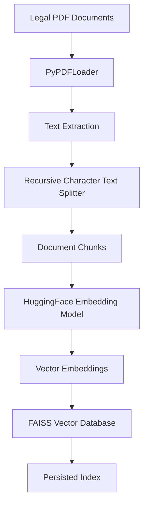
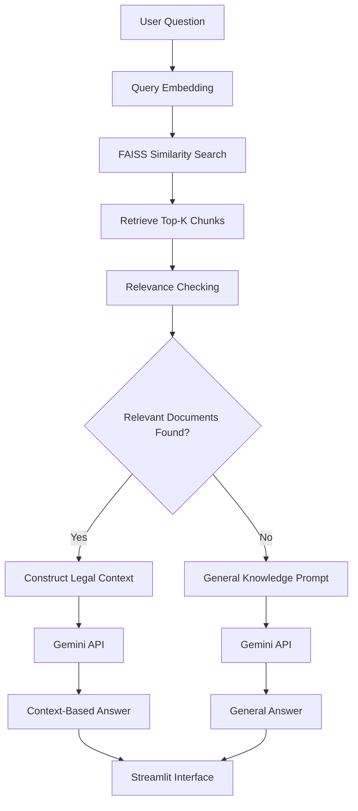

# ⚖️ NyayaAI – Indian Legal Research Assistant

**An AI-powered legal document retrieval and question-answering system for the Indian judicial system.**

NyayaAI is a Retrieval-Augmented Generation (RAG) based legal research assistant designed to help users search legal documents and obtain answers to legal questions using an AI-powered conversational interface.

The system uses PDF document processing, semantic embeddings, FAISS vector search, and Google's Gemini API to retrieve relevant legal information and generate natural-language responses.

It also supports general knowledge questions when relevant information is not found in the legal document database.

---

## 📑 Table of Contents

1. [Project Overview](#-project-overview)
2. [Problem Statement](#-problem-statement)
3. [Project Objectives](#-project-objectives)
4. [Key Features](#-key-features)
5. [Technology Stack](#-technology-stack)
6. [System Architecture](#-system-architecture)
7. [Project Workflow](#-project-workflow)
8. [Project Structure](#-project-structure)
9. [Technology Explanation](#-technology-explanation)
10. [Installation and Setup](#-installation-and-setup)
11. [Gemini API Configuration](#-gemini-api-configuration)
12. [Running the Application](#-running-the-application)
13. [Example Questions](#-example-questions)
14. [Retrieval Evaluation](#-retrieval-evaluation)
15. [Screenshots](#-screenshots)
16. [Limitations](#-limitations)
17. [Future Improvements](#-future-improvements)
18. [Research and Academic Contribution](#-research-and-academic-contribution)
19. [Disclaimer](#-disclaimer)
20. [Author](#-author)

---

## 📌 Project Overview

Accessing relevant legal information can be challenging because Indian judicial documents are distributed across different courts, repositories, and legal databases.

Traditional keyword-based searches may fail to identify documents that are semantically related to a user's question.

NyayaAI addresses this challenge through semantic search and Retrieval-Augmented Generation.

Users can ask questions in natural language. The application searches its legal document database, retrieves relevant text chunks, and uses a Large Language Model (LLM) to generate a contextual response.

The project initially focuses on legal documents related to Bihar, including documents from district courts, the Patna High Court, and digital legal repositories.

### Main Idea

Instead of asking an LLM to answer every question using only its pretrained knowledge, NyayaAI first attempts to retrieve relevant information from its legal document collection.

This helps connect generated answers with the actual documents available in the knowledge base.

---

## 🎯 Problem Statement

Legal information is often distributed across large collections of PDF documents, court judgments, acts, rules, and other legal publications.

Users may face several challenges:

- Finding relevant legal documents.
- Searching through lengthy PDF files.
- Understanding complex legal terminology.
- Identifying relevant information from multiple documents.
- Obtaining contextual answers without manually reading entire documents.

NyayaAI aims to simplify legal document discovery by combining semantic document retrieval with AI-powered question answering.

---

## 🎯 Project Objectives

The primary objectives are:

1. Develop a searchable knowledge base of Indian judicial and legal documents.
2. Extract text from legal PDF documents.
3. Divide lengthy documents into smaller, meaningful chunks.
4. Generate semantic embeddings for document chunks.
5. Store embeddings in a FAISS vector database.
6. Retrieve relevant legal information using semantic similarity search.
7. Generate contextual answers using Google's Gemini API.
8. Provide a general knowledge fallback when relevant documents are unavailable.
9. Develop an interactive web interface using Streamlit.
10. Evaluate the quality of document retrieval.

---

## 🚀 Key Features

| Feature | Description |
|---|---|
| Legal PDF Processing | Extracts text from legal PDF documents. |
| Text Chunking | Divides lengthy documents into smaller chunks. |
| Semantic Embeddings | Converts text into numerical vector representations. |
| FAISS Search | Performs similarity-based document retrieval. |
| RAG Pipeline | Uses retrieved legal information as context for answer generation. |
| Gemini Integration | Generates natural-language answers using Gemini. |
| General Knowledge Fallback | Supports questions outside the available legal knowledge base. |
| Interactive Interface | Provides a conversational interface through Streamlit. |
| Source Information | Displays retrieved document information where available. |

---

## 🛠️ Technology Stack

| Technology | Purpose |
|---|---|
| Python | Main programming language |
| Streamlit | Web application interface |
| LangChain | Document loading, chunking, and vector-store integration |
| PyPDFLoader | PDF document loading |
| RecursiveCharacterTextSplitter | Text chunking |
| HuggingFace Sentence Transformers | Semantic embedding generation |
| all-MiniLM-L6-v2 | Embedding model |
| FAISS | Vector similarity search |
| Google Gemini API | Large Language Model for response generation |
| python-dotenv | Environment variable management |

---

## 🏗️ System Architecture

The following diagram illustrates the intended document ingestion and question-answering architecture.

### 1. Document Ingestion Pipeline



### 2. Question Answering Pipeline



---

## 🔄 Project Workflow

### Step 1: Legal Document Collection

The project uses PDF documents related to the Indian judicial system.

The current collection includes categories such as:

- Bihar District Courts.
- Patna High Court.
- Digital Repository.
- Acts and other legal documents.

The documents are stored inside the `Data/` directory.

### Step 2: PDF Loading

The system uses LangChain's `PyPDFLoader` to load PDF documents and extract their textual content.

Example:

```python
from langchain_community.document_loaders import PyPDFLoader

loader = PyPDFLoader("./Data/example.pdf")

documents = loader.load()

print("Total pages:", len(documents))
```

Each loaded page is represented as a document containing text and metadata.

### Step 3: Text Chunking

Long legal documents are divided into smaller text chunks.

The project uses `RecursiveCharacterTextSplitter`.

Example:

```python
from langchain_text_splitters import RecursiveCharacterTextSplitter

text_splitter = RecursiveCharacterTextSplitter(
    chunk_size=1000,
    chunk_overlap=200
)

texts = text_splitter.split_documents(documents)

print("Total chunks:", len(texts))
```

**Chunk size:** 1000 characters.

**Chunk overlap:** 200 characters.

Chunk overlap helps preserve contextual continuity between adjacent chunks.

### Step 4: Embedding Generation

The text chunks are converted into numerical vector representations using HuggingFace embeddings.

Embedding model:

`sentence-transformers/all-MiniLM-L6-v2`

Example:

```python
from langchain_huggingface import HuggingFaceEmbeddings

embeddings = HuggingFaceEmbeddings(
    model_name="sentence-transformers/all-MiniLM-L6-v2"
)
```

These embeddings represent the semantic meaning of the text and enable similarity-based retrieval.

### Step 5: FAISS Vector Database

FAISS is used to store and search the generated embeddings.

Example:

```python
from langchain_community.vectorstores import FAISS

vectorstore = FAISS.from_documents(
    texts,
    embeddings
)

vectorstore.save_local("faiss_db")
```

The persisted vector database can be loaded later without repeating the complete ingestion process.

### Step 6: Similarity Search

When a user asks a question, the system searches the FAISS database for semantically similar document chunks.

Example:

```python
results = vectorstore.similarity_search_with_score(
    question,
    k=3
)
```

The system retrieves the top three matching chunks in this example.

The retrieved distances are used by the current implementation for relevance checking.

**Note:** The relevance threshold is an experimental setting and should be calibrated through evaluation rather than treated as a universal value.

### Step 7: Relevance Checking

The system checks whether the retrieved documents are sufficiently relevant to the user's question.

Two possible paths follow:

- Relevant legal documents are found: construct a context-based prompt.
- Relevant legal documents are not found: use a general knowledge prompt.

This avoids treating every FAISS retrieval result as automatically sufficient evidence.

### Step 8: Gemini Response Generation

The Google Gemini API receives the appropriate prompt.

For the RAG path, the prompt contains the user question and retrieved legal context.

For the fallback path, the prompt requests a general answer without claiming that it has been verified against the legal database.

### Step 9: Display the Answer

Streamlit provides the conversational interface.

The application displays the generated answer and, where available, information about retrieved documents.

---

## 📁 Project Structure

The following structure represents the project organization discussed during development.

```text
Final_year_Project/
│
├── Data/
│   ├── Bihar_District_Courts/
│   ├── Patna_High_Court/
│   ├── Digital_Repository/
│   └── Other_Legal_Documents/
│
├── faiss_db/
│   └── FAISS index files
│
├── __pycache__/
│
├── app.py
├── Chunking.py
├── Embedding.py
├── Database.py
├── Retrieval.py
├── EvaluateRetrieval.py
│
├── test_gemini.py
├── .env
├── .gitignore
└── README.md
```

### File Descriptions

| File | Responsibility |
|---|---|
| `app.py` | Streamlit application and Gemini-powered question answering. |
| `Chunking.py` | PDF text chunking logic. |
| `Embedding.py` | Embedding generation. |
| `Database.py` | FAISS vector database creation and persistence. |
| `Retrieval.py` | Document retrieval operations. |
| `EvaluateRetrieval.py` | Retrieval evaluation experiments. |
| `test_gemini.py` | Gemini API connectivity testing. |
| `Data/` | Legal PDF document collection. |
| `faiss_db/` | Persisted FAISS vector database. |

---

## ⚙️ Installation and Setup

Follow these instructions to run NyayaAI locally on Windows.

### Prerequisites

Install the following:

- Python 3.10 or later.
- Visual Studio Code.
- Git.
- Internet connection.
- Google Gemini API key.

### Step 1: Clone the Repository

```bash
git clone YOUR_GITHUB_REPOSITORY_URL
```

Navigate into the project:

```bash
cd Final_year_Project
```

Replace the placeholder with your actual GitHub repository URL.

### Step 2: Create a Virtual Environment

```bash
python -m venv venv
```

### Step 3: Activate the Environment

For Windows PowerShell:

```powershell
.\venv\Scripts\Activate.ps1
```

If PowerShell blocks script execution, use an appropriate execution policy for your environment or activate the environment through Command Prompt:

```cmd
venv\Scripts\activate.bat
```

### Step 4: Install Dependencies

Install the core dependencies:

```bash
pip install streamlit
pip install langchain-community
pip install langchain-text-splitters
pip install langchain-huggingface
pip install sentence-transformers
pip install faiss-cpu
pip install pypdf
pip install google-genai
pip install python-dotenv
```

Depending on the imports in the remaining source files, additional packages may be necessary.

### Step 5: Configure Environment Variables

Create a `.env` file in the project root.

```env
GEMINI_API_KEY=your_gemini_api_key
```

Do not upload this file to GitHub.

---

## 🔑 Gemini API Configuration

NyayaAI uses Google's Gemini API for natural-language answer generation.

To obtain an API key:

1. Visit [Google AI Studio](https://aistudio.google.com/).
2. Sign in with your Google account.
3. Open the API Keys section.
4. Generate an API key.
5. Store the key in your local `.env` file.

Example Python integration:

```python
from dotenv import load_dotenv
from google import genai
import os

load_dotenv()

api_key = os.getenv("GEMINI_API_KEY")

client = genai.Client(api_key=api_key)
```

The application currently uses the model configured in `app.py`. Check that file for the exact model identifier before running.

### Security Recommendations

Never commit the following to a public repository:

- `.env`
- API keys.
- Credentials.
- Private legal documents.
- Sensitive user data.

A recommended `.gitignore`:

```gitignore
# Environment variables
.env

# Virtual environment
venv/
.venv/

# Python cache
__pycache__/
*.pyc

# IDE settings
.vscode/

# Temporary files
*.log

# Local test outputs
```

Only publish the FAISS database and legal documents if you have permission to redistribute them.

---

## ▶️ Running the Application

After installing dependencies and configuring the Gemini API key, run:

```bash
python -m streamlit run app.py
```

The Streamlit application will start locally.

Open the URL displayed in your terminal, normally:

```text
http://localhost:8501
```

You should see the NyayaAI interface.

### Application Interface

The interface contains:

- NyayaAI title and description.
- Legal PDF knowledge-base information.
- FAISS retrieval information.
- Gemini model information.
- Chat input.
- Conversation history.
- Retrieved-document information where available.
- Clear conversation option.

---

## 💬 Example Questions

The following questions can be used to test the application.

| Category | Example Question |
|---|---|
| Indian Civil Law | What is the Code of Civil Procedure, 1908? |
| Legal Documents | Explain the purpose of a legal act. |
| Court Information | What is the role of a District Court? |
| Legal Research | Find information about a particular legal provision in the available documents. |
| General Knowledge | What is the capital of Japan? |

### Expected Application Behavior

**Case 1: Relevant legal information exists**

The system retrieves matching document chunks and sends the retrieved context to Gemini.

Mode:

`RAG - Answer based on retrieved legal documents`

**Case 2: Relevant legal information is unavailable**

The system uses the general knowledge fallback.

Mode:

`General LLM`

General answers should not be treated as verified legal information.

---

## 📊 Retrieval Evaluation

The project includes an `EvaluateRetrieval.py` script for retrieval evaluation experiments.

Retrieval quality is important because the final generated answer depends on the relevance of the retrieved document chunks.

The following metrics are useful for evaluating a semantic retrieval system:

| Metric | Purpose |
|---|---|
| Precision@K | Measures the proportion of relevant results among the top K retrieved results. |
| Recall@K | Measures how many relevant documents are retrieved among the top K results. |
| Mean Reciprocal Rank (MRR) | Measures the ranking position of the first relevant result. |
| Mean Average Precision (MAP) | Measures ranking quality across multiple queries. |
| Normalized Discounted Cumulative Gain (NDCG) | Measures ranking quality while considering relevance and position. |

These metrics are suggested evaluation criteria; their actual implementation and numerical results should be reported only after inspecting and running the evaluation script.

A future evaluation should compare different chunk sizes, overlap values, embedding models, and retrieval configurations.

---

## 📸 Screenshots

Add application screenshots here after finalizing the interface.

### 1. NyayaAI Home Page

```markdown

```

### 2. Legal Document Question Answering

```markdown

```

### 3. General Knowledge Fallback

```markdown

```

### 4. Retrieved Document Sources

```markdown

```

Create a `screenshots/` directory in the repository and add the corresponding images before publishing.

---

## ⚠️ Limitations

The current project has several areas that require further improvement:

1. **Document Coverage:** The current knowledge base does not necessarily cover the entire Indian judicial system.
2. **Retrieval Accuracy:** Semantic similarity alone cannot guarantee that retrieved documents contain sufficient evidence to answer a question.
3. **Relevance Threshold:** The retrieval threshold requires calibration using a representative evaluation dataset.
4. **Legal Interpretation:** AI-generated explanations may omit important legal details or misinterpret complex provisions.
5. **Document Quality:** Scanned PDFs, poor formatting, and extraction errors may affect retrieval quality.
6. **General Knowledge Responses:** Fallback answers are not verified against the legal document database.
7. **API Dependency:** Gemini-based generation depends on API availability, network connectivity, and applicable usage limits.

---

## 🔮 Future Improvements

Potential improvements include:

- Expand the legal document collection across Indian states and courts.
- Add more High Court and Supreme Court judgments.
- Implement hybrid retrieval using BM25 and FAISS.
- Integrate a cross-encoder reranker.
- Improve document-aware and structure-aware chunking.
- Develop an evidence-sufficiency classifier.
- Improve source citations with document names, page numbers, and relevant passages.
- Support multilingual legal queries.
- Add legal document summarization.
- Implement user authentication and conversation management.
- Develop a benchmark dataset for retrieval and answer evaluation.
- Improve hallucination detection and answer verification.
- Explore domain-specific legal embeddings.

---

## 🎓 Research and Academic Contribution

NyayaAI explores the application of modern Natural Language Processing and Large Language Models to legal information retrieval.

The project combines several important concepts:

1. **Information Retrieval:** Finding relevant legal documents from a large document collection.
2. **Semantic Search:** Retrieving information based on meaning rather than exact keyword matches.
3. **Vector Databases:** Storing and searching document embeddings efficiently.
4. **Retrieval-Augmented Generation:** Grounding generated answers in retrieved external documents.
5. **LLM Integration:** Using Gemini for natural-language answer generation.
6. **Retrieval Evaluation:** Studying the quality of retrieved information.

The project demonstrates how RAG-based systems can be applied to domain-specific knowledge bases such as the Indian judicial system.

---

## ⚖️ Disclaimer

NyayaAI is an academic and research project developed for educational purposes.

It is intended to assist with legal document discovery and provide informational explanations.

It does not replace professional legal advice, legal consultation, or official judicial records.

Users should independently verify important legal information using authentic and authoritative legal sources.

AI-generated responses may contain errors or incomplete interpretations.

---

## 👨‍💻 Author

**Bikram Kumar**

B.Tech – Computer Science and Engineering  
National Institute of Technology, Mizoram

Interested in:

- Backend Development
- Data Structures and Algorithms
- Artificial Intelligence
- Retrieval-Augmented Generation
- Natural Language Processing
- System Design

---

## 🙏 Acknowledgements

I would like to acknowledge the open-source communities and developers behind Python, LangChain, HuggingFace, FAISS, Streamlit, and Google Gemini for providing the technologies that make this project possible.

**Built with the goal of making Indian legal information more accessible through AI.**

⭐ If you find this project interesting, consider giving the repository a star.