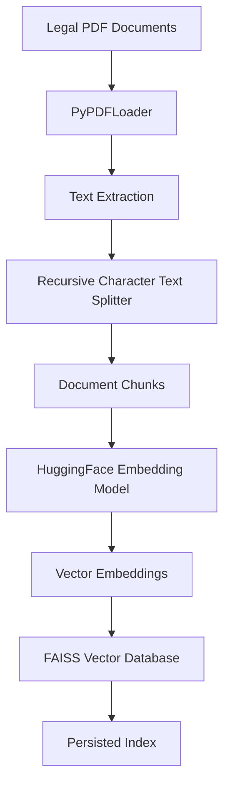
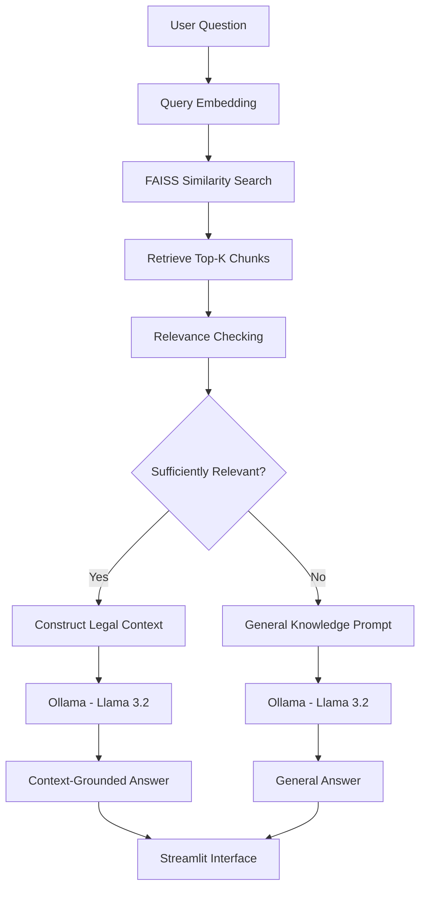

# ⚖️ NyayaAI – Indian Legal Research Assistant

**An AI-powered legal document retrieval and question-answering system for the Indian judicial system using Retrieval-Augmented Generation (RAG).**

NyayaAI is a RAG-based legal research assistant that allows users to ask natural-language questions about Indian legal documents and receive contextual answers grounded in a curated PDF knowledge base.

The system combines PDF processing, semantic embeddings, FAISS vector search, and a locally hosted **Llama 3.2 model through Ollama** to retrieve relevant legal information and generate responses.

It also supports general-knowledge questions when sufficient information is not available in the legal document database.

---

## 📑 Table of Contents

1. Project Overview
2. Problem Statement
3. Project Objectives
4. Key Features
5. Technology Stack
6. System Architecture
7. Project Workflow
8. Project Structure
9. Installation and Setup
10. Ollama Configuration
11. Running the Application
12. Example Questions
13. Retrieval Evaluation
14. Screenshots
15. Limitations
16. Future Improvements
17. Research and Academic Contribution
18. Disclaimer
19. Author

---

## 📌 Project Overview

Accessing relevant legal information can be challenging because Indian judicial documents are distributed across different courts, repositories, and legal databases.

Traditional keyword-based searches may fail to identify documents that are semantically related to a user's question.

NyayaAI addresses this challenge through semantic search and Retrieval-Augmented Generation.

Users can ask questions in natural language. The application searches its legal document database, retrieves relevant text chunks, and uses a locally hosted Large Language Model (LLM) to generate contextual responses.

The current project focuses on legal documents related to Bihar, including documents from district courts, the Patna High Court, and digital legal repositories.

### Main Idea

Instead of relying entirely on an LLM's pretrained knowledge, NyayaAI first attempts to retrieve relevant information from its legal document collection.

The retrieved passages are supplied as context to the LLM to generate document-grounded answers.

---

## 🎯 Problem Statement

Legal information is distributed across large collections of PDF documents, court judgments, acts, rules, and other legal publications.

Users may face several challenges:

- Finding relevant legal documents.
- Searching through lengthy PDF files.
- Understanding complex legal terminology.
- Identifying relevant information from multiple documents.
- Obtaining contextual answers without manually reading entire documents.

NyayaAI aims to simplify legal document discovery by combining semantic document retrieval with AI-powered question answering.

---

## 🎯 Project Objectives

1. Develop a searchable knowledge base of Indian judicial and legal documents.
2. Extract text from legal PDF documents.
3. Divide lengthy documents into smaller chunks.
4. Generate semantic embeddings for document chunks.
5. Store embeddings in a FAISS vector database.
6. Retrieve relevant legal information using semantic similarity search.
7. Generate contextual answers using Llama 3.2 through Ollama.
8. Provide a general-knowledge fallback when relevant documents are unavailable.
9. Develop an interactive interface using Streamlit.
10. Evaluate the quality of document retrieval.

---

## 🚀 Key Features

| Feature | Description |
|---|---|
| Legal PDF Processing | Extracts text from legal PDF documents. |
| Text Chunking | Divides lengthy documents into smaller chunks. |
| Semantic Embeddings | Converts text into numerical vector representations. |
| FAISS Search | Performs similarity-based document retrieval. |
| RAG Pipeline | Uses retrieved legal information as context for answer generation. |
| Ollama Integration | Generates answers using a locally hosted Llama 3.2 model. |
| General Knowledge Fallback | Supports questions outside the available legal knowledge base. |
| Interactive Interface | Provides a conversational interface through Streamlit. |
| Source Information | Displays retrieved document information where available. |
| Local Inference | Avoids external LLM API calls during inference. |

---

## 🛠️ Technology Stack

| Technology | Purpose |
|---|---|
| Python | Main programming language |
| Streamlit | Web application interface |
| LangChain | Document processing and vector-store integration |
| PyPDFLoader | PDF document loading |
| RecursiveCharacterTextSplitter | Text chunking |
| HuggingFace Sentence Transformers | Semantic embedding generation |
| all-MiniLM-L6-v2 | Embedding model |
| FAISS | Vector similarity search |
| Ollama | Local LLM runtime |
| Llama 3.2 | Language model for answer generation |
| langchain-ollama | LangChain integration with Ollama |

---

## 🏗️ System Architecture

### 1. Document Ingestion Pipeline



### 2. Question Answering Pipeline



---

## 🔄 Project Workflow

### Step 1: Legal Document Collection

The project uses PDF documents related to the Indian judicial system.

The current collection includes:

- Bihar District Courts.
- Patna High Court.
- Digital Repository.
- Acts and other legal documents.

Documents are stored inside the `Data/` directory.

### Step 2: PDF Loading

The system uses LangChain's `PyPDFLoader` to extract textual content from PDF documents.

### Step 3: Text Chunking

Long legal documents are divided into smaller text chunks using `RecursiveCharacterTextSplitter`.

Current configuration:

- Chunk size: 1000 characters.
- Chunk overlap: 200 characters.

Chunk overlap helps preserve contextual continuity between adjacent chunks.

### Step 4: Embedding Generation

Text chunks are converted into numerical vector representations using:

`sentence-transformers/all-MiniLM-L6-v2`

The embedding model produces 384-dimensional vectors for semantic similarity search.

### Step 5: FAISS Vector Database

FAISS stores and searches the generated embeddings.

The vector database is persisted locally so that the complete ingestion pipeline does not need to run for every application session.

### Step 6: Similarity Search

When a user asks a question, the system searches the FAISS database and retrieves the top-k matching chunks.

The current default retrieval value is:

`k = 5`

Retrieved scores are used by the relevance-checking logic.

### Step 7: Relevance Checking

The system evaluates whether retrieved chunks pass the configured relevance threshold.

Two paths are possible:

- Relevant legal information is found: construct a context-based RAG prompt.
- Relevant legal information is insufficient: use a general-knowledge prompt.

The threshold is an experimental setting and should be calibrated using the evaluation dataset.

### Step 8: Local LLM Response Generation

The system uses **Ollama with Llama 3.2** to generate natural-language answers.

For RAG, the prompt contains the user's question and retrieved legal context.

For fallback, the prompt requests a general answer without claiming that it has been verified against the legal database.

### Step 9: Display the Answer

Streamlit provides the conversational interface.

The application displays generated answers and, for RAG-grounded responses, information about retrieved documents.

---

## 📁 Project Structure

```text
Final_year_Project/
│
├── Data/
│   ├── Bihar_District_Courts/
│   ├── Patna_High_Court/
│   ├── Digital_Repository/
│   └── Other_Legal_Documents/
│
├── faiss_db/
│   └── FAISS index files
│
├── app.py
├── Chunking.py
├── Embeding.py
├── Database.py
├── Retrieval.py
├── EvaluateRetrieval.py
├── test.py
├── .gitignore
├── README.md
└── requirements.txt
```

### File Descriptions

| File | Responsibility |
|---|---|
| `app.py` | Streamlit application and user interface. |
| `Chunking.py` | PDF loading and text chunking. |
| `Embeding.py` | Embedding generation. |
| `Database.py` | FAISS vector database creation and persistence. |
| `Retrieval.py` | Document retrieval, relevance checking and LLM integration. |
| `EvaluateRetrieval.py` | Retrieval evaluation experiments. |
| `test.py` | Project testing utilities. |
| `Data/` | Legal PDF document collection. |
| `faiss_db/` | Persisted FAISS vector database. |

---

## ⚙️ Installation and Setup

Follow these instructions to run NyayaAI locally on Windows.

### Prerequisites

Install the following:

- Python 3.10 or later.
- Visual Studio Code.
- Git.
- Ollama.
- An internet connection for downloading dependencies, the embedding model and the LLM.

### Step 1: Clone the Repository

```bash
git clone YOUR_GITHUB_REPOSITORY_URL
```

Navigate into the project:

```bash
cd Final_year_Project
```

Replace the placeholder with your actual GitHub repository URL.

### Step 2: Create a Virtual Environment

```bash
python -m venv venv
```

### Step 3: Activate the Environment

For Windows PowerShell:

```powershell
.\venv\Scripts\Activate.ps1
```

### Step 4: Install Dependencies

```bash
pip install streamlit
pip install langchain-community
pip install langchain-text-splitters
pip install langchain-huggingface
pip install langchain-ollama
pip install sentence-transformers
pip install faiss-cpu
pip install pypdf
```

Install any additional dependencies required by your source files.

---

## 🦙 Ollama Configuration

NyayaAI uses Ollama to run the Llama 3.2 model locally.

Unlike cloud-based LLM APIs, Ollama allows the application to perform inference using a locally hosted model.

### Step 1: Install Ollama

Download and install Ollama:

https://ollama.com/download

### Step 2: Download Llama 3.2

Open PowerShell or Command Prompt and run:

```bash
ollama pull llama3.2
```

This downloads the model to your local machine.

### Step 3: Verify the Installation

Run:

```bash
ollama list
```

You should see the downloaded `llama3.2` model.

You can also test the model:

```bash
ollama run llama3.2
```

### Step 4: Start the Ollama Service

Ensure the Ollama service is running locally.

The default local endpoint is:

```text
http://localhost:11434
```

### Step 5: LangChain Integration

NyayaAI uses `ChatOllama` to communicate with the locally hosted model.

Example:

```python
from langchain_ollama import ChatOllama

llm = ChatOllama(
    model="llama3.2",
    temperature=0
)
```

No Gemini API key or cloud LLM API key is required for this integration.

---

## ▶️ Running the Application

After installing the dependencies and downloading the required Ollama model, run:

```bash
python -m streamlit run app.py
```

The Streamlit application will start locally.

Open the URL displayed in your terminal, normally:

```text
http://localhost:8501
```

You should now see the NyayaAI interface.

### Application Interface

The application provides:

- NyayaAI title and description.
- Legal document question input.
- FAISS-based document retrieval.
- Local Llama 3.2 response generation.
- Retrieved-document information where available.
- Answer modes: Auto, Documents only, and General.
- Conversation regeneration and export options.

---

## 💬 Example Questions

| Category | Example Question |
|---|---|
| Indian Civil Law | What is the Code of Civil Procedure, 1908? |
| Legal Documents | Explain the purpose of a legal act. |
| Court Information | What is the role of a District Court? |
| Legal Research | Find information about a particular legal provision in the available documents. |
| General Knowledge | What is the capital of Japan? |

### Expected Application Behavior

**Case 1: Relevant legal information exists**

The system retrieves matching document chunks and sends the retrieved context to Llama 3.2.

**Case 2: Relevant legal information is unavailable**

The system uses its general-knowledge fallback.

General answers should not be treated as verified legal information.

---

## 📊 Retrieval Evaluation

The project includes an `EvaluateRetrieval.py` script for retrieval evaluation experiments.

The following metrics are useful for evaluating a semantic retrieval system:

| Metric | Purpose |
|---|---|
| Precision@K | Measures the proportion of relevant results among the top K retrieved results. |
| Recall@K | Measures how many relevant documents are retrieved among the top K results. |
| Mean Reciprocal Rank (MRR) | Measures the ranking position of the first relevant result. |
| Mean Average Precision (MAP) | Measures ranking quality across multiple queries. |
| Normalized Discounted Cumulative Gain (NDCG) | Measures ranking quality while considering relevance and position. |

Numerical evaluation results should be reported only after executing the evaluation script on the labelled dataset.

---

## 📸 Screenshots

Add application screenshots after finalizing the interface.

### 1. NyayaAI Home Page


### 2. Legal Document Question Answering


### 3. General Knowledge Fallback


### 4. Retrieved Document Sources


Create a `screenshots/` directory and add the corresponding images before publishing.

---

## ⚠️ Limitations

1. **Document Coverage:** The current knowledge base does not necessarily cover the entire Indian judicial system.
2. **Retrieval Accuracy:** Semantic similarity alone cannot guarantee that retrieved documents contain sufficient evidence.
3. **Relevance Threshold:** The retrieval threshold requires calibration using a representative evaluation dataset.
4. **Legal Interpretation:** AI-generated explanations may omit important legal details or misinterpret complex provisions.
5. **Document Quality:** Scanned PDFs, poor formatting and extraction errors may affect retrieval quality.
6. **General Knowledge Responses:** Fallback answers are not verified against the legal document database.
7. **Local Hardware Dependency:** Running Llama 3.2 locally requires sufficient system resources.

---

## 🔮 Future Improvements

Potential improvements include:

- Expand the legal document collection across Indian states and courts.
- Add more High Court and Supreme Court judgments.
- Implement hybrid retrieval using BM25 and FAISS.
- Integrate a cross-encoder reranker.
- Improve document-aware and structure-aware chunking.
- Develop an evidence-sufficiency classifier.
- Improve source citations with document names, page numbers and relevant passages.
- Support multilingual legal queries.
- Add legal document summarization.
- Implement user authentication and conversation management.
- Develop a benchmark dataset for retrieval and answer evaluation.
- Improve hallucination detection and answer verification.
- Explore domain-specific legal embeddings.

---

## 🎓 Research and Academic Contribution

NyayaAI explores the application of modern Natural Language Processing and Large Language Models to legal information retrieval.

The project combines:

1. **Information Retrieval:** Finding relevant legal documents from a large document collection.
2. **Semantic Search:** Retrieving information based on meaning rather than exact keyword matches.
3. **Vector Databases:** Storing and searching document embeddings efficiently.
4. **Retrieval-Augmented Generation:** Grounding generated answers in retrieved external documents.
5. **Local LLM Integration:** Using Ollama and Llama 3.2 for natural-language answer generation.
6. **Retrieval Evaluation:** Studying the quality of retrieved information.

The project demonstrates how RAG-based systems can be applied to domain-specific knowledge bases such as the Indian judicial system.

---

## ⚖️ Disclaimer

NyayaAI is an academic and research project developed for educational purposes.

It is intended to assist with legal document discovery and provide informational explanations.

It does not replace professional legal advice, legal consultation or official judicial records.

Users should independently verify important legal information using authentic and authoritative legal sources.

AI-generated responses may contain errors or incomplete interpretations.

---

## 👨‍💻 Author

**Bikram Kumar**

B.Tech – Computer Science and Engineering  
National Institute of Technology, Mizoram

Interested in:

- Backend Development
- Data Structures and Algorithms
- Artificial Intelligence
- Retrieval-Augmented Generation
- Natural Language Processing
- System Design

---

## 🙏 Acknowledgements

I would like to acknowledge the open-source communities and developers behind Python, LangChain, HuggingFace, FAISS, Streamlit and Ollama for providing the technologies that make this project possible.

**Built with the goal of making Indian legal information more accessible through AI.**

⭐ If you find this project interesting, consider giving the repository a star.
